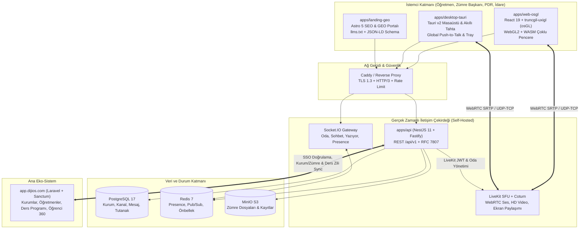
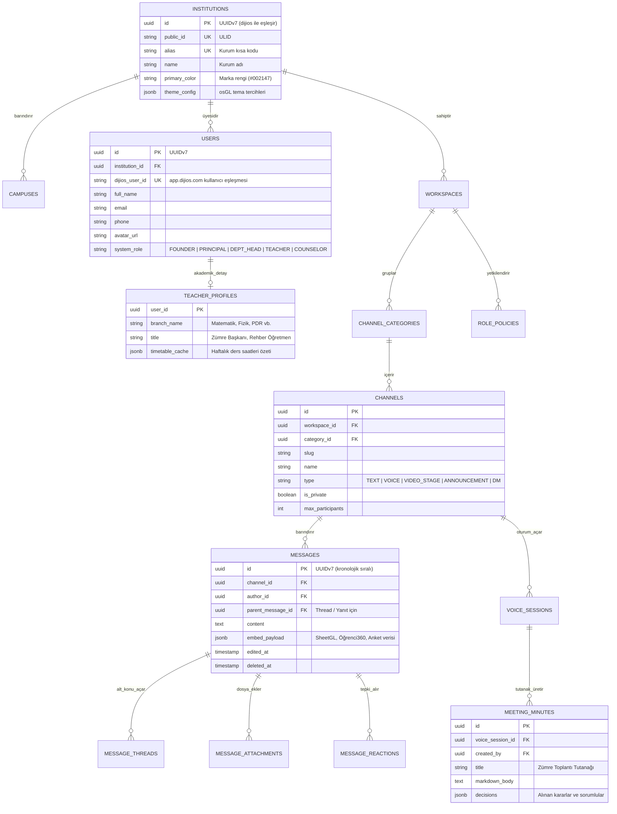
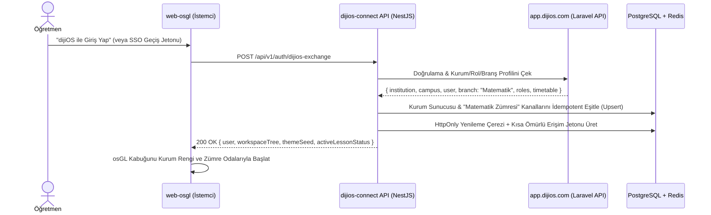
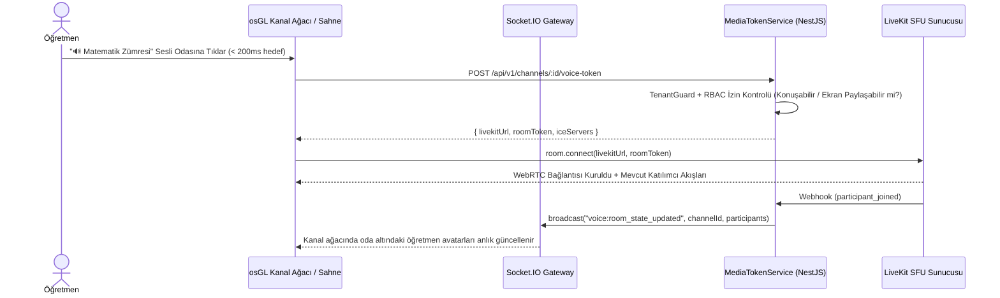

# dijiOS Connect (`Dijios_discord`) — Uçtan Uca Mimari ve Uygulama Referans Planı

> **Belge Statüsü:** Ana Mühendislik Anayasası ve Uygulama Referansı (`Single Source of Truth`)  
> **Ekosistem:** [dijiOS Akıllı Okul İşletim Sistemi](https://app.dijios.com/) × [truncgil-uxigl (`osGL` v2.9.7)](https://uxigl.truncgil.com/demos/osgl) × [Apple Human Interface Guidelines](https://developer.apple.com/design/human-interface-guidelines/)  
> **Repo:** `https://github.com/Faruk-T/Dijios_discord`  
> **Temel Mühendislik İlkeleri:** SOLID · Clean Architecture · Dosya Başına Maksimum **300 Satır** Kod Kuralı · Atomik Commit Disiplini · SEO & GEO (Generative Engine Optimization) Uyumluluğu

---

## İçindekiler

1. [Vizyon, Ürün Konumlandırması ve K12NET Karşılaştırmalı Analizi](#1-vizyon-ürün-konumlandırması-ve-k12net-karşılaştırmalı-analizi)
2. [Mühendislik Anayasası: SOLID, 300 Satır Kuralı ve Atomik Commit Standardı](#2-mühendislik-anayasası-solid-300-satır-kuralı-ve-atomik-commit-standardı)
3. [Teknoloji Yığını ve Monorepo Dizin Mimarisi (`pnpm` + `Turborepo`)](#3-teknoloji-yığını-ve-monorepo-dizin-mimarisi-pnpm--turborepo)
4. [Tasarım Sistemi: `truncgil-uxigl` (`osGL`) × Apple HIG × `dijiOS` Kimliği](#4-tasarım-sistemi-truncgil-uxigl-osgl--apple-hig--dijios-kimliği)
5. [Veritabanı Şeması (PostgreSQL 17 + Prisma) ve Redis Veri Yapıları](#5-veritabanı-şeması-postgresql-17--prisma-ve-redis-veri-yapıları)
6. [`dijiOS` (`app.dijios.com`) Entegrasyonu, SSO Köprüsü ve KVKK Güvenliği](#6-dijios-appdijioscom-entegrasyonu-sso-köprüsü-ve-kvkk-güvenliği)
7. [Gerçek Zamanlı İletişim (Socket.IO) ve Ses/Görüntü Motoru (LiveKit SFU)](#7-gerçek-zamanlı-iletişim-socketio-ve-sesgörüntü-motoru-livekit-sfu)
8. [SEO ve GEO (Generative Engine Optimization) Stratejisi](#8-seo-ve-geo-generative-engine-optimization-stratejisi)
9. [Faz Faz Uygulama Yol Haritası, Milestone'lar ve Atomik Issue Kırılımı (Faz 0 – Faz 7)](#9-faz-faz-uygulama-yol-haritası-milestonelar-ve-atomik-issue-kırılımı-faz-0--faz-7)
10. [Test Piramidi, CI/CD Boru Hattı, Docker Altyapısı ve GitHub Kanban İş Akışı](#10-test-piramidi-cicd-boru-hattı-docker-altyapısı-ve-github-kanban-iş-akışı)

---

## 1. Vizyon, Ürün Konumlandırması ve K12NET Karşılaştırmalı Analizi

### 1.1 Ürün Amacı
**`dijiOS`** (`app.dijios.com`), öğrencilerin akademik, finansal, rehberlik (PDR), devam-devamsızlık, ölçme-değerlendirme ve 360° gelişim süreçlerini A'dan Z'ye yöneten modern bir Akıllı Okul İşletim Sistemidir (ERP / SIS / LMS).

**`dijiOS Connect` (`Dijios_discord`)**, `dijiOS` ekosisteminin **gerçek zamanlı akademik iletişim, zümre işbirliği ve sesli/görüntülü oda katmanıdır**. Öğretmenlerin, zümre başkanlarının, PDR uzmanlarının, kampüs idarecilerinin ve kurucu yöneticilerin; harici ve okul verisinden kopuk tüketici uygulamalarına (WhatsApp grupları, Zoom linkleri, kişisel Discord sunucuları) ihtiyaç duymadan, **doğrudan okulun kurumsal çatısı altında oda oda (sesli, görüntülü, ekran paylaşımlı ve yazılı)** iletişim kurmasını sağlar.

### 1.2 K12NET ve Geleneksel Sistemlere Karşı Mimari Üstünlük

| Boyut | Geleneksel Sistemler (K12NET vb.) | WhatsApp / Harici Zoom | `dijiOS` + `dijiOS Connect` (`osGL`) |
| :--- | :--- | :--- | :--- |
| **İletişim Modeli** | Hantal, e-posta benzeri tek yönlü iç mesaj kutusu ve SMS | Dağınık gruplar, kaybolan linkler, kişisel numara paylaşımı | **Discord hızında kalıcı sesli/görüntülü zümre odaları, alt konular (Threads) ve anlık mesajlaşma** |
| **Kullanıcı Arayüzü (UI/UX)** | Tablo/form ağırlıklı eski nesil kurumsal ekranlar | Tüketici sohbet ekranı (çoklu pencere yok) | **`truncgil-uxigl` (`osGL`) Liquid Glass masaüstü kabuğu + Apple HIG uyumlu çoklu yüzen pencere deneyimi** |
| **Akademik Bağlam** | Mesajlaşma ile öğrenci/ders verisi birbirinden kopuk | Okul sisteminden tamamen habersiz | **Canlı ders programı durumu (*"10-A Matematik Dersinde"*), tek tıkla Öğrenci 360° kartı ve `SheetGL` analiz paylaşımı** |
| **Ses & Görüntü (AV)** | Yok (harici Zoom/Meet entegrasyonuna muhtaç) | Link oluşturma/bekleme odası sürtünmesi | **Tek tıkla odaya gir-çık (Drop-in Voice/Video), 50+ kişilik LiveKit SFU, 1080p/60fps ekran paylaşımı ve gürültü engelleme** |
| **Veri Güvenliği & KVKK** | Parçalı yetkilendirme | Öğrenci verilerinin yurt dışı tüketici bulutlarına sızma riski | **%100 Kurum İzolasyonlu (Multi-Tenant), kendi sunucunda (Self-Hosted LiveKit + MinIO) KVKK tam uyumlu mimari** |
| **Keşfedilebilirlik** | Kapalı/eski dokümantasyon | Kurumsal ürün kimliği yok | **Tam Teknik SEO + GEO (`llms.txt`, JSON-LD Schema.org, AI arama motoru otoritesi)** |

---

## 2. Mühendislik Anayasası: SOLID, 300 Satır Kuralı ve Atomik Commit Standardı

### 2.1 Katı "Maksimum 300 Satır Kod" Kuralı (`<= 300 LOC`)
Okunabilirliği, test edilebilirliği ve bakım hızını en üst düzeyde tutmak için **projedeki hiçbir kaynak kod dosyası (`.ts`, `.tsx`, `.js`, `.mjs`, `.css`, `.prisma`, `.rs`) 300 fiziksel satırı (`300 lines`) geçemez.**

- **İdeal Hedef Aralığı:** `80 – 200` satır.
- **Uyarı Eşiği (Refactoring Sinyali):** `240` satıra ulaşan her modül alt sorumluluklarına bölünür.
- **Sert Üst Sınır (CI Reddi):** `301.` satır yazıldığı anda ESLint, Pre-commit kancası ve GitHub Actions CI boru hattı derlemeyi durdurur.

#### Dosya Parçalama (Decomposition) Deseni
Bir özellik (örneğin *Sesli Oda Katılımcı Izgarası*) tek bir dev `VoiceRoom.tsx` (900 satır) olarak **yazılmaz**; sorumluluklarına göre aşağıdaki atomik dosyalara ayrılır:
1. `voice-room.contracts.ts` (`~60 satır`) — Saf TypeScript arayüzleri ve prop kontratları.
2. `useVoiceRoomConnection.ts` (`~120 satır`) — LiveKit bağlantı yaşam döngüsü kancası.
3. `useActiveSpeakerLayout.ts` (`~95 satır`) — Konuşan kişiyi algılama ve ızgara hesaplama mantığı.
4. `VoiceParticipantTile.tsx` (`~140 satır`) — Tekil öğretmen video/avatar kartı ve ses dalgası göstergesi.
5. `VoiceControlDock.tsx` (`~130 satır`) — Mikrofon, sağırlaştırma, kamera, ekran paylaşımı ve ayrılma butonları.
6. `VoiceStageWindow.tsx` (`~110 satır`) — `osGL` pencere kabuğu içinde bileşenleri birleştiren üst görünüm.

#### 3 Katmanlı Otomatik 300-Satır Denetimi
1. **ESLint Kuralı (`packages/config/eslint/base.mjs`):**
   ```js
   "max-lines": ["error", { "max": 300, "skipBlankLines": false, "skipComments": false }],
   "max-lines-per-function": ["warn", { "max": 90, "skipBlankLines": true, "skipComments": true }]
   ```
2. **Repo Geneli Denetleyici (`scripts/check-file-lines.mjs`):** CSS, Prisma alt şemaları ve Rust dosyaları dahil tüm kaynak dosyaların satır sayısını tarar; 300 satırı aşan dosya varsa dosya adını ve satır sayısını raporlayıp `exit(1)` döner.
3. **Husky `pre-commit` + GitHub Actions `quality-gate.yml`:** Kuralı ihlal eden hiçbir commit ana dala (`main`) giremez.

---

### 2.2 SOLID Prensiplerinin Somut Mimari Karşılıkları

1. **S — Single Responsibility Principle (Tek Sorumluluk):**
   - Görsel bileşenler (`*View.tsx`, `*Tile.tsx`) yalnızca `truncgil-uxigl` atomlarını kullanarak render işlemi yapar; doğrudan `fetch`, `socket.emit` veya `localStorage` çağırmaz.
   - İş kuralları Domain servislerinde, veri erişimi Repository katmanında, gerçek zamanlı olay senkronizasyonu Store/Hook adaptörlerinde yaşar.
2. **O — Open/Closed Principle (Açık/Kapalı):**
   - `osGL` pencere yöneticisi yeni uygulama pencerelerine (`WindowAppDescriptor` kayıt defteri üzerinden) açıktır; yeni bir akademik araç (örn. *Zümre Oylama Penceresi*) eklendiğinde `WindowManager` çekirdek kodu değiştirilmez, sadece kayıt listesine yeni eklenti (plugin) eklenir.
   - Mesaj ekleri (`Dosya`, `SheetGL Tablosu`, `Öğrenci 360 Kartı`, `Ses Kaydı`, `Anket`) `MessageEmbedRendererRegistry` üzerinden genişletilir.
3. **L — Liskov Substitution Principle (Liskov Yerine Geçme):**
   - `AuthProviderPort` kontratını uygulayan `DijiosSanctumAuthAdapter` (canlı `app.dijios.com` köprüsü) ile `MockSchoolAuthAdapter` (yerel geliştirme ve E2E test ortamı) birbirinin yerine sıfır kod değişikliğiyle geçebilir.
   - `MediaTransportPort` kontratını uygulayan `LiveKitTransportAdapter` ile test ortamındaki `SimulatedMediaAdapter` birebir aynı davranış garantisini verir.
4. **I — Interface Segregation Principle (Arayüz Ayrımı):**
   - `truncgil-uxigl` kütüphanesinin `src/core/contracts/*` felsefesi korunarak dev "God Object" tipler yasaklanmıştır. Bunun yerine `IdentifiableEntity`, `TenantScoped`, `AuthorSummary`, `VoiceStateFlags`, `ChannelPermissions` gibi küçük, amaca yönelik kontratlar birleştirilir.
5. **D — Dependency Inversion Principle (Bağımlılıkların Tersine Çevrilmesi):**
   - Backend'de NestJS modülleri somut Prisma veya LiveKit SDK sınıflarına değil, `Symbol` tabanlı soyut portlara (`USER_REPOSITORY_PORT`, `MEDIA_TOKEN_PORT`, `DIJIOS_SYNC_PORT`) bağımlıdır.
   - Frontend'de özellik modülleri React Context üzerinden enjekte edilen soyut servis kontratlarını tüketir.

---

### 2.3 Atomik Commit ve Git Akışı Anayasası

Her commit **tek bir mantıksal değişikliği** temsil etmeli, kendi başına derlenebilmeli (`build` + `typecheck` + `lint` + `check-lines` başarılı olmalı) ve geri alınabilir (`git revert`) olmalıdır.

#### Commit Mesaj Formatı (Conventional Commits)
```text
<tip>(<kapsam>): <emir kipinde kısa özet - maks 72 karakter> (#issue_no)

- Yapılan somut değişiklik 1
- Yapılan somut değişiklik 2
```

- **İzin Verilen Tipler:**
  - `feat`: Yeni bir kullanıcı veya API özelliği (`feat(voice): add livekit active speaker highlight (#26)`)
  - `fix`: Hata düzeltmesi (`fix(auth): handle expired dijios xsrf cookie rotation (#9)`)
  - `arch`: Mimari iskelet, kontrat veya modül sınırı tanımı (`arch(contracts): define tenant-scoped channel events (#4)`)
  - `refactor`: Davranışı değiştirmeden kod iyileştirme / 300 satır bölme (`refactor(chat): split composer attachment tray (#19)`)
  - `test`: Birim, entegrasyon veya E2E test ekleme (`test(rbac): verify department head channel mute guard (#10)`)
  - `docs`: Dokümantasyon ve mimari kayıtlar (`docs(plan): add end-to-end implementation blueprint`)
  - `chore` / `ci` / `perf`: Yapılandırma, CI/CD ve performans optimizasyonları

#### Altın Atomik Commit Kuralları
1. **"Ve" Bağlacı Testi:** Commit mesajını yazarken *"X eklendi **ve** Y düzeltildi"* diyorsanız bu **iki ayrı atomik commit** olmalıdır.
2. **Boyut Disiplini:** Tek bir atomik commit ideal olarak `1 – 6` dosyayı etkiler; yeni bağımlılık kurulumu (`chore(deps)`) ile iş mantığı (`feat(...)`) aynı commit içinde karıştırılmaz.
3. **Dal (Branch) Stratejisi:** Her GitHub Issue için `main` dalından `<tip>/issue-<no>-<kisa-ad>` (örn. `feat/issue-11-osgl-shell-boot`) dalı açılır, atomik commitlerle geliştirilir ve PR üzerinden CI kontrolleri geçtikten sonra birleştirilir.

---

## 3. Teknoloji Yığını ve Monorepo Dizin Mimarisi (`pnpm` + `Turborepo`)

### 3.1 Teknoloji Seçimleri Özeti

| Katman | Teknoloji | Seçim Gerekçesi |
| :--- | :--- | :--- |
| **Monorepo & Paket Yönetimi** | `pnpm` Workspaces + `Turborepo` | Önbellekli paralel derleme, katı bağımlılık izolasyonu, ortak TS kontratları |
| **İstemci Uygulama Kabuğu** | `React 19` + `Vite 6` + `TypeScript 5.7` | `app.dijios.com` ve `truncgil-uxigl` ile %100 uyumlu modern SPA motoru |
| **Tasarım Sistemi & Masaüstü OS** | `truncgil-uxigl` (`^2.9.7`) + `osGL` (`OSGLEngine` WebGL2 + WASM) | Liquid Glass yüzeyler, 60fps yüzen pencereler, `Sidebar dual-column`, `Messenger`, `SheetGL`, `FileManGL` |
| **İstemci Durum Yönetimi** | `Zustand` (dilimlenmiş atomik store'lar) + `TanStack Query v5` | Yüksek frekanslı ses/presence güncellemelerinde sıfır gereksiz render + önbellekli REST |
| **SEO & GEO Keşif Portalı** | `Astro 5` (SSR/SSG) + `Schema.org JSON-LD` + `llms.txt` | Sıfır gereksiz JS, `< 1.0s` LCP, yapay zeka arama motorları için maksimum semantik netlik |
| **Masaüstü İstemcisi** | `Tauri v2` (Rust) + PWA | Akıllı tahtalar ve öğretmen bilgisayarları için `< 10MB` kurulum, global Bas-Konuş (PTT) kısayolu |
| **Backend API & Sinyalizasyon** | `NestJS 11` (`Fastify` adaptörü) + `Socket.IO` (Redis Adapter) | SOLID DI konteyneri, yüksek eşzamanlılık, yatay ölçeklenebilir gerçek zamanlı odalar |
| **Veritabanı & Önbellek** | `PostgreSQL 17` + `Prisma` (`prismaSchemaFolder`) + `Redis 7` | Çoklu dosyalı (`<= 300` satır) tip güvenli şema, tam metin arama, milisaniyelik presence |
| **Ses, Görüntü & Ekran Paylaşımı** | `LiveKit Server` (Self-Hosted Go/WebRTC SFU) + `Coturn` | 50+ kişilik düşük gecikmeli zümre odaları, Simulcast, Dynacast, ekran sesi paylaşımı |
| **Dosya & Kayıt Depolama** | `MinIO` (Self-Hosted S3 uyumlu) | Zümre evrakları, ders materyalleri ve toplantı kayıtları için KVKK uyumlu yerel depolama |

### 3.2 Sistem Mimarisi Diyagramı



### 3.3 Monorepo Dizin Yapısı (Her Dosya `<= 300` Satır Garantili)

```text
dijios_discord/
├── apps/
│   ├── web-osgl/                        # Ana osGL Öğretmen İletişim İstemcisi (Vite + React 19)
│   │   ├── public/
│   │   │   └── fonts/                   # Yerel WOFF2: Inter Variable, Plus Jakarta Sans, JetBrains Mono
│   │   └── src/
│   │       ├── app/                     # Providers, Router, DI Container, Bootstrap
│   │       ├── osgl-shell/              # TopMenuBar, WindowRegistry, Dock, Wallpaper, Widgets
│   │       ├── features/
│   │       │   ├── auth/                # dijiOS SSO & Mock Kurum Girişi ekranları/kancaları
│   │       │   ├── servers-channels/    # Kampüs ikonu rayı + Zümre ses/metin kanal ağacı
│   │       │   ├── messaging/           # Mesaj akışı, Threads, Tepkiler, Zengin Composer
│   │       │   ├── voice-video/         # LiveKit Ses/Görüntü Sahnesi, Ekran Paylaşımı, PiP Penceresi
│   │       │   ├── presence-timetable/  # Canlı öğretmen durumu & dijiOS ders zili entegrasyonu
│   │       │   ├── academic-tools/      # Zümre tutanağı, SheetGL tablo, FileManGL arşiv, Öğrenci 360
│   │       │   └── settings-studio/     # Ses/Video cihaz kalibrasyonu & OS Tema Stüdyosu
│   │       └── styles/                  # dijios-oxford tohum tokenları & Apple HIG yardımcı stilleri
│   │
│   ├── landing-geo/                     # SEO & GEO Uyumlu Tanıtım, Karşılaştırma ve Doküman Portalı
│   │   ├── public/
│   │   │   ├── robots.txt               # AI bot (GPTBot, Google-Extended, PerplexityBot) izin kuralları
│   │   │   ├── llms.txt                 # GEO: LLM özet referans dosyası
│   │   │   └── llms-full.txt            # GEO: Tam ürün ve mimari bilgi tabanı
│   │   └── src/
│   │       ├── components/seo/          # JsonLdGraph, OpenGraphMeta, CitationFactBox
│   │       └── pages/                   # Ana sayfa, K12NET karşılaştırması, Güvenlik/KVKK, Rehberler
│   │
│   ├── desktop-tauri/                   # Windows / macOS / Pardus (Akıllı Tahta) Tauri v2 Kabuğu
│   │   └── src-tauri/
│   │       └── src/                     # main.rs, tray.rs, shortcuts.rs (Global Push-to-Talk)
│   │
│   └── api/                             # NestJS 11 (Fastify) + Socket.IO + LiveKit Orkestratörü
│       ├── prisma/
│       │   └── schema/                  # Çoklu şema dosyaları (tenant.prisma, chat.prisma, voice.prisma...)
│       └── src/
│           ├── common/                  # RFC 7807 ProblemDetails filtresi, TenantGuard, Decorators
│           ├── modules/
│           │   ├── auth/                # Sanctum/JWT doğrulama + MockAuth adaptörü
│           │   ├── dijios-bridge/       # app.dijios.com Kurum, Zümre ve Ders Programı senkronizasyonu
│           │   ├── workspaces/          # Kampüs sunucuları, Zümre kategorileri ve Kanallar
│           │   ├── rbac/                # Okul rolleri (Kurucu, Müdür, Zümre Bşk., Öğretmen, PDR)
│           │   ├── messaging/           # Mesajlar, Alt konular (Threads), Tepkiler, Arama
│           │   ├── realtime/            # Socket.IO Gateway'leri (parçalanmış: chat, presence, voice)
│           │   ├── media-livekit/       # LiveKit oda jetonu üretimi, Webhook alıcısı, Kayıt kontrolü
│           │   ├── files/               # MinIO imzalı yükleme/indirme servisi
│           │   └── minutes/             # Zümre toplantı tutanakları ve karar takibi
│           └── main.ts
│
├── packages/
│   ├── contracts/                       # %100 Paylaşımlı DTO, Zod Şemaları, Socket Olay Haritaları
│   ├── ui-osgl/                         # truncgil-uxigl sarmalayıcıları ve özel akademik osGL bileşenleri
│   └── config/                          # Paylaşımlı ESLint (max-lines: 300), TSConfig, Prettier
│
├── infra/
│   └── docker/                          # PostgreSQL 17, Redis 7, LiveKit SFU, Coturn, MinIO compose dosyaları
├── scripts/
│   └── check-file-lines.mjs             # 300 satır sınırı denetleyici betik
├── implementation_plan.md               # Ana referans planı (bu belge)
├── turbo.json
└── pnpm-workspace.yaml
```

---

## 4. Tasarım Sistemi: `truncgil-uxigl` (`osGL`) × Apple HIG × `dijiOS` Kimliği

### 4.1 `dijiOS` Marka Tohumu (`dijios-oxford`) ve Yerel Tipografi
`app.dijios.com` üzerinde kullanılan kurumsal kimlik, `truncgil-uxigl` `CssVariableThemeEngine` içerisine varsayılan kurumsal tema tohumu (`data-seed="dijios-oxford"`) olarak tanımlanır ve her okulun kendi `primary_color` (`GET /api/v1/public/institutions`) rengiyle dinamik olarak zenginleştirilebilir:

- **Ana Kurumsal Renkler:**
  - `--djs-oxford-navy`: `#002147` (Birincil derin lacivert — güven ve akademik otorite)
  - `--djs-prussian-navy`: `#1D3557` (İkincil vurgu ve hover katmanı)
  - `--djs-steel-cerulean`: `#457B9D` (`OS` vurgusu, aktif kanal ve bağlantı tonu)
  - **Durum Renkleri (Presence):** Çevrimiçi `#10B981`, Derste (*Otomatik DND*) `#F59E0B`, Nöbette `#3B82F6`, Toplantıda/Meşgul `#EF4444`, Çevrimdışı `#64748B`.
- **Sıfır Harici CDN Font İlkesi:** `app.dijios.com` ile birebir aynı şekilde `Inter Variable`, `Plus Jakarta Sans Variable` ve `JetBrains Mono Variable` WOFF2 dosyaları yerel paket içinden sunulur; dış ağa font isteği atılmaz (KVKK ve kapalı okul ağları uyumu).

### 4.2 Apple Human Interface Guidelines (HIG) Uyumluluk Matrisi

Apple HIG tasarım ilkeleri `truncgil-uxigl/uxu-tokens.css` değişkenleriyle birebir eşleştirilmiştir:

1. **Katman Hiyerarşisi ve Liquid Glass Kuralı (Materials & Vibrancy):**
   - **Yüzen İşlevsel Katman (*Floating Functional Layer*):** Üst menü çubuğu (`TopMenuBar`), alt `Dock`, `CommandPalette` (`⌘K`) ve yüzen mini video penceresi (`PiP Stage`) `--uxu-liquid-regular-bg` (`32px` bulanıklık, `%180` doygunluk, `--uxu-specular-inset` ışık kırılması) kullanır.
   - **İçerik Katmanı (*Content Layer*):** Kanal ağacı (`ultraThin` / `thin`), mesaj akışı (`--uxu-bg-elevated` opak/yarı-opak zemin) ve sağ katılımcı paneli (`regular` materyal) okunabilirliği maksimumda tutar.
   - **Cam Üstüne Cam Yasağı (HIG Kuralı):** İki şeffaf Liquid Glass yüzeyi asla doğrudan üst üste bindirilmez; pencere içi kartlar her zaman `--uxu-surface-tonal` veya `--uxu-surface-elevated` kullanır.
2. **Sürekli Köşe Eğriliği (Squircle) ve 8pt Uzamsal Izgara:**
   - Tüm uygulama ikonları, öğretmen avatarları (`<Avatar shape="squircle" />`) ve pencereler Apple'ın kesintisiz eğrilik estetiğini ve `8pt` (`--uxu-space-2` katları) boşluk ritmini izler.
3. **Doğal Yay Fiziği (Spring Motion) ve Erişilebilirlik:**
   - Pencere açılış/kapanışları ve panel geçişleri `--uxu-spring: cubic-bezier(0.22, 1, 0.36, 1)` kullanır.
   - İşletim sisteminde *"Hareketi Azalt"* (`prefers-reduced-motion: reduce`) veya düşük donanımlı akıllı tahta modu seçildiğinde `data-reduced-motion="true"` ve `data-webgl="false"` devreye girerek WebGL shader duvar kağıdını statik gradyana, bulanıklıkları opak yüzeylere düşürür (60fps performans garantisi).

### 4.3 `osGL` × Discord Hibrit Çalışma Alanı Kurgusu

Standart Discord'da ekran paylaşımı izlerken başka bir zümre kanalında yazışmak veya not çizelgesi açmak mevcut ekranı kapatır. **`dijiOS Connect`**, `osGL` pencere motorunu Discord'un çift sütunlu kanal hızıyla birleştirir:

```text
+--------------------------------------------------------------------------------------------------+
| [dijiOS Logo] dijiOS Connect  | Okul: Fen Lisesi ▾ | Odalar  Zümreler  Pencere  | [🟢 Matematik Odası 04:18] [⌘K] [3.Ders: 14dk] 14:22 |
+--------------------------------------------------------------------------------------------------+
|  +--- Pencere 1: İletişim Merkezi (Dual-Column) ---+   +--- Pencere 2: Canlı Görüntülü Zümre ---+ |
|  | ● ● ●   Fen Lisesi · Zümre Kanalları            |   | ● ● ●   🔊 Matematik Zümresi (6 Kişi)  | |
|  +------+-------------------+----------------------+   +----------------------------------------+ |
|  | [FL] | ▾ GENEL           | # matematik-zumresi  |   | +----------------+  +----------------+ | |
|  | [OO] |   # duyurular     |----------------------|   | | Ayşe Hoca (Bşk)|  | Mehmet Hoca    | | |
|  | [MZ] |   🔊 ÖğretmenOdası| Ayşe Hoca  14:18     |   | | [Aktif Konuşan]|  | [Ekran Paylaş.]| | |
|  | [FZ] | ▾ ZÜMRELER        | Sınav analiz tablosu |   | +----------------+  +----------------+ | |
|  | [PD] |   # mat-zumresi   | ektedir 👇           |   | +------------------------------------+ | |
|  |      |   🔊 Mat Toplantı | [SheetGL Önizleme]   |   | | 📊 11. Sınıflar Deneme Analizi     | | |
|  +------+-------------------+                      |   | +------------------------------------+ | |
|  | 🎙️ Açık 🎧 Açık | Derste Değil | [Mesaj yaz... 📎]   |   |   [🎙️ Sessiz] [📷 Kamera] [🖥️ Ekran] [❌] | |
|  +-------------------------------------------------+   +----------------------------------------+ |
|                                                                                                  |
|                    +--------------------------------------------------------+                    |
|                    |  [💬 Kanallar] [🎥 Sahne] [📁 Zümre Arşivi] [📝 Tutanak] [🎨 Tema]  |  <- Liquid Glass Dock
|                    +--------------------------------------------------------+                    |
+--------------------------------------------------------------------------------------------------+
```

- **Mobil ve Tablet Uyumluluğu:** Ekran genişliği `< 768px` olduğunda `osGL` otomatik olarak `<MobileLauncher />` ve tam ekran kaydırılabilir `.osgl-mobile-compact` sayfalarına dönüşür; öğretmen koridorda veya nöbette cep telefonundan tek elle sesli odaya bağlanabilir.

---

## 5. Veritabanı Şeması (PostgreSQL 17 + Prisma) ve Redis Veri Yapıları

### 5.1 Birincil Anahtar ve Çoklu-Kurum (Multi-Tenant) Standardı
`app.dijios.com` ana veritabanı mimarisiyle birebir uyumlu olacak şekilde:
- Tüm tablolarda dahili birincil anahtar **`id` (UUIDv7 — zaman sıralı, B-Tree indeks dostu)**, dış API/URL kimliği ise **`public_id` (ULID)** olarak tutulur.
- Kurum verisi barındıran her tabloda **`institution_id` (UUIDv7)** zorunludur ve uygulama katmanında `TenantScopeExtension` ile otomatik filtrelenir.
- Prisma `prismaSchemaFolder` özelliği kullanılarak şema dosyaları modül bazında bölünür (hiçbir `.prisma` dosyası 300 satırı geçmez).

### 5.2 Varlık-İlişki Diyagramı (`erDiagram`)



### 5.3 Redis 7 Anahtar Uzayı (Key-Space) Tasarımı
- `presence:{institutionId}:{userId}` (`Hash`, TTL `90s` kalp atışı): `{ status: 'ONLINE' | 'IN_CLASS' | 'ON_DUTY' | 'IN_VOICE' | 'DND', currentLesson: '10-A Matematik', activeChannelId }`
- `typing:{channelId}` (`Sorted Set`, skor = zaman damgası): Kanalda o an yazmakta olan öğretmenler.
- `voice:room:{channelId}:participants` (`Hash`): LiveKit webhook ve sinyalizasyon ile senkronize anlık oda katılımcıları (kanal ağacında odaya girmeden içeride kimlerin göründüğünü listelemek için!).
- `ratelimit:{ip_or_user}:{route}` (`String` / Sliding Window): Mesaj spam ve API hız sınırlaması.

---

## 6. `dijiOS` (`app.dijios.com`) Entegrasyonu, SSO Köprüsü ve KVKK Güvenliği

### 6.1 Çoklu-Kurum Kimlik Doğrulama ve Otomatik Zümre Provizyonu
Öğretmenler ikinci bir şifre ezberlemez. `app.dijios.com` içerisindeki üst menüden veya doğrudan `connect.dijios.com` adresinden mevcut kurum ve telefon/e-posta bilgileriyle giriş yaparlar.



- **Geliştirme Ortamı (`MockSchoolAuthAdapter`):** Canlı `app.dijios.com` API'sine bağımlı kalmadan çevrimdışı ve otomatik testlerde çalışabilmek için `AUTH_MODE=mock` seçildiğinde örnek bir *"Örnek Fen ve Teknoloji Koleji"* kurumu, 6 farklı branştan örnek öğretmen hesabı (Kurucu, Müdür, Matematik Zümre Bşk., Fizik Öğretmeni, PDR Uzmanı, Nöbetçi Öğretmen) tek tıkla simüle edilir.

### 6.2 Akıllı Ders Programı Durumu (*Timetable-Aware Presence*)
`dijiOS`'taki ders programı (`AttendanceAndTimetable`) verisiyle senkronize çalışan zamanlayıcı:
- Öğretmenin dersi başladığında durumunu otomatik olarak **`🟡 Derste (11-A Fizik — Bitiş 11:20)`** yapar ve sesli arama / masaüstü bildirimlerini sessize alır.
- Teneffüs zili çaldığında durumu tekrar **`🟢 Çevrimiçi (Öğretmenler Odasına Uygun)`** durumuna döndürür.

### 6.3 KVKK ve Güvenlik Kontrolleri
- **PDR (Rehberlik) Gizlilik Duvarı:** PDR odaları (`is_private: true, category: PDR`) kriptografik kanal anahtarlarıyla ve sıkı RBAC kurallarıyla korunur; sistem yöneticisi dahi açık yetki olmadan PDR vaka görüşme odalarına veya tutanaklarına erişemez.
- **RFC 7807 Hata Standardı:** Tüm API hataları `app.dijios.com` ile uyumlu olarak `application/problem+json` (`type`, `title`, `status`, `detail`, `code`, `errors`) formatında döner.
- **İmzalı Medya Erişimi:** MinIO S3 üzerindeki hiçbir zümre dosyası herkese açık (`public`) değildir; yalnızca o kanala erişim yetkisi doğrulanmış öğretmene `15` dakikalık `Presigned URL` üretilir.

---

## 7. Gerçek Zamanlı İletişim (Socket.IO) ve Ses/Görüntü Motoru (LiveKit SFU)

### 7.1 Neden P2P Değil, Self-Hosted LiveKit SFU?
P2P (Peer-to-Peer) bağlantılarda 8 kişilik bir zümre toplantısında her öğretmen 7 ayrı video akışı yüklemek (`upload`) zorunda kalır ve okul interneti tıkanır. **LiveKit SFU (Selective Forwarding Unit)** mimarisinde:
- Her öğretmen sunucuya **yalnızca 1 kez** (Simulcast ile Yüksek/Orta/Düşük katmanlı) yayın gönderir.
- LiveKit sunucusu, izleyen öğretmenin pencere boyutuna göre (`osGL`'de küçük pencere ise `360p`, tam ekran ise `1080p 60fps`) doğru katmanı iletir (**Dynacast**).
- 50+ kişilik genel öğretmenler kurulu toplantıları bile düşük CPU ve düşük bant genişliğiyle kesintisiz çalışır.

### 7.2 Sesli/Görüntülü Odaya Katılım ve Ekran Paylaşımı Akışı



### 7.3 Öğretmen Odaklı Ses & Görüntü Özellikleri
1. **Öğretmenler Odası Gürültü Engelleme:** WebAudio / RNNoise tabanlı arka plan gürültü bastırma filtresi sayesinde kalabalık öğretmenler odasından konuşan öğretmenin yalnızca kendi sesi net iletilir.
2. **Akıllı Tahta & Belge Odaklı Ekran Paylaşımı:** `contentHint = "detail"` optimizasyonu ile PDF soru kitapçıkları, `SheetGL` sınav çizelgeleri ve küçük puntolu metinler bulanıklaşmadan jilet keskinliğinde paylaşılır.
3. **Söz İsteme (El Kaldırma) & Sahne Modu (`VIDEO_STAGE`):** Genel kurul ve veli/zümre seminerlerinde konuşmacılar sahnede yer alır, dinleyiciler tek tıkla el kaldırarak (`hand:raise`) söz alarak sahneye davet edilir.
4. **Hızlı Tepkiler ve Sesli Oda İçi Sohbet:** Kamerası kapalı olan veya o an konuşamayan öğretmenler sesli oda penceresinin yan çekmecesinden yazılı not ve anlık emoji tepkisi (`👍`, `👏`, `❓`) gönderebilir.

---

## 8. SEO ve GEO (Generative Engine Optimization) Stratejisi

Projenin hem geleneksel arama motorlarında (Google, Bing, Yandex) hem de yeni nesil yapay zeka yanıt motorlarında (**ChatGPT Search, Google Gemini / AI Overviews, Perplexity, Claude**) *"Türkiye'nin en modern K12 okul iletişim ve yönetim ekosistemi"* olarak birinci sırada referans gösterilmesi için `apps/landing-geo` özel olarak tasarlanmıştır.

### 8.1 Teknik SEO Standartları
- **Performans Hedefleri:** Lighthouse `100/100` SEO & Erişilebilirlik, `LCP < 1.2s`, `CLS < 0.02`, `INP < 80ms` (Astro 5 sıfır-JS statik/SSR mimarisi).
- **Semantik HTML ve Meta Mimarisi:** Doğru başlık hiyerarşisi (`h1` -> `h2` -> `h3`), kanonik URL'ler (`rel="canonical"`), Türkçe dil bildirimi (`lang="tr-TR"`), dinamik OpenGraph görselleri ve otomatik `sitemap-index.xml`.
- **Hedef Küme Sayfaları (Topic Clusters):**
  - `/ozellikler/zumre-sesli-goruntulu-odalar`
  - `/ozellikler/dijios-akilli-ders-programi-entegrasyonu`
  - `/karsilastirma/dijios-vs-k12net-modern-okul-yonetimi`
  - `/guvenlik/kvkk-uyumlu-okul-ici-iletisim`
  - `/dokumantasyon/*` (Herkese açık kurulum, kullanım ve mimari rehberler)

### 8.2 GEO (Generative Engine Optimization) Mimarisi
Yapay zeka modelleri pazarlama sloganlarını değil; **yapılandırılmış gerçekleri, net karşılaştırma tablolarını, teknik spesifikasyonları ve standartlaştırılmış makine okunur özetleri** kaynak (citation) olarak seçer:

1. **`/llms.txt` ve `/llms-full.txt` Standardı:**
   - Kök dizinde sunulan `/llms.txt`, `dijiOS` ve `dijiOS Connect` ekosisteminin amacını, modüllerini, K12NET gibi eski nesil sistemlerden mimari farklarını, güvenlik (KVKK) standartlarını ve resmi dokümantasyon bağlantılarını temiz Markdown formatında LLM tarayıcılarına sunar.
2. **Zengin `JSON-LD` Varlık Grafiği (`Schema.org`):**
   - `SoftwareApplication` (`applicationCategory: "EducationalApplication"`, `operatingSystem: "Web, Windows, macOS, iOS, Android"`, `featureList`),
   - `Organization` (`dijiOS` / `Trunçgil Teknoloji` varlık ilişkisi),
   - `FAQPage` (Okul kurucularının ve bilgi işlem yöneticilerinin en sık sorduğu sorular ve net yanıtları),
   - `HowTo` (*"5 Dakikada Okul Zümre Odaları Nasıl Kurulur?"*).
3. **Alıntılanabilir Yanıt Blokları (*Answer-First Content Design*):**
   - Her rehber ve özellik sayfasının ilk 60 kelimesi, doğrudan bir LLM yanıtında kaynak gösterilebilecek netlikte *"Tanım + Somut Ölçüt + Mimari Kanıt"* formülüyle yazılır.
4. **Akıllı `robots.txt` ve Gizlilik Sınırı:**
   - Tanıtım ve dokümantasyon rotalarında `GPTBot`, `OAI-SearchBot`, `Google-Extended`, `ClaudeBot`, `PerplexityBot` tarayıcılarına açık izin (`Allow`) verilir.
   - Özel kurum çalışma alanlarında (`/app/*`, `/api/*`, `/{kurum-kodu}/*`) `Disallow` + `X-Robots-Tag: noindex, nofollow, noarchive` başlığı uygulanarak hiçbir okul veya öğretmen verisinin arama motorlarına/LLM'lere sızmaması garanti altına alınır.

---

## 9. Faz Faz Uygulama Yol Haritası, Milestone'lar ve Atomik Issue Kırılımı (Faz 0 – Faz 7)

Proje **8 ana faz (Milestone M0 – M7)** ve her fazın altında tek tek atomik olarak geliştirilecek **36 GitHub Issue (Task)** halinde planlanmıştır. Her task tamamlandığında çalışan, test edilmiş ve hiçbir dosyası 300 satırı aşmayan bir çıktı üretir.

---

### Faz 0 (Milestone M0): Vakıf, Monorepo, Kalite Kapıları ve 300-Satır CI Mimarisi
**Hedef:** Geliştirme ortamının, `pnpm + Turborepo` iskeletinin, paylaşımlı tip kontratlarının, Docker altyapısının ve 300-satır otomatik kalite kapılarının sıfır hatayla ayağa kaldırılması.

- **Task #1 — `[M0-T1]` Monorepo İskeleti (`pnpm` + `Turborepo`) ve Paylaşımlı TSConfig Kurulumu**
  - *Üretilecek Dosyalar:* `package.json`, `pnpm-workspace.yaml`, `turbo.json`, `packages/config/tsconfig/*.json`.
  - *Kabul Kriteri:* `pnpm build`, `pnpm dev`, `pnpm typecheck` komutları tüm çalışma alanlarında çalışır.
  - *Örnek Atomik Commit:* `chore(monorepo): bootstrap pnpm workspaces and turborepo pipeline (#1)`
- **Task #2 — `[M0-T2]` 300-Satır Kuralı Denetleyicisi, ESLint Flat Config, Prettier ve Husky Kancaları**
  - *Üretilecek Dosyalar:* `packages/config/eslint/base.mjs`, `scripts/check-file-lines.mjs`, `.prettierrc`, `.husky/pre-commit`, `.husky/commit-msg` (`commitlint`).
  - *Kabul Kriteri:* 301 satırlık test dosyası oluşturulduğunda `pnpm check:lines` ve `pnpm lint` anında hata verir; bozuk commit mesajı reddedilir.
  - *Örnek Atomik Commit:* `chore(quality): enforce strict 300-line file cap and conventional commit hooks (#2)`
- **Task #3 — `[M0-T3]` `@dijios-connect/contracts` Çekirdek Tip, RFC 7807 ve Olay Sözlüğü Paketi**
  - *Üretilecek Dosyalar:* `packages/contracts/src/{entities,events,errors,permissions,index}.ts` (her biri `< 150` satır).
  - *Kabul Kriteri:* Hem `apps/api` hem `apps/web-osgl` ortak tipleri derleme hatası olmadan içeri aktarır.
  - *Örnek Atomik Commit:* `arch(contracts): add shared domain contracts and rfc7807 problem types (#3)`
- **Task #4 — `[M0-T4]` Docker Geliştirme Altyapısı (PostgreSQL 17, Redis 7, LiveKit SFU, MinIO)**
  - *Üretilecek Dosyalar:* `infra/docker/docker-compose.yml`, `infra/docker/livekit.yaml`, `.env.example`.
  - *Kabul Kriteri:* Tek komutla (`docker compose up -d`) tüm servisler sağlık kontrolünden (`healthy`) geçer.
  - *Örnek Atomik Commit:* `chore(infra): configure local docker stack with postgres, redis, livekit, and minio (#4)`
- **Task #5 — `[M0-T5]` GitHub Actions Sürekli Entegrasyon (CI) Kalite Kapısı Boru Hattı**
  - *Üretilecek Dosyalar:* `.github/workflows/ci-quality-gate.yml`.
  - *Kabul Kriteri:* Her PR ve `main` push işleminde satır sınırı, lint, tip kontrolü ve birim testleri otomatik koşar.
  - *Örnek Atomik Commit:* `ci(actions): add automated lint, typecheck, test, and 300-line gate workflow (#5)`

---

### Faz 1 (Milestone M1): `dijiOS` Kimlik Köprüsü, Çoklu-Kurum (Multi-Tenant) ve RBAC Çekirdeği
**Hedef:** Backend API çekirdeğinin (`NestJS 11 + Fastify`), çoklu şemalı Prisma veritabanının, `app.dijios.com` SSO/Mock kimlik doğrulamasının ve okul rol/yetki motorunun tamamlanması.

- **Task #6 — `[M1-T1]` NestJS 11 + Fastify Çekirdeği, Sağlık Uç Noktası ve RFC 7807 Hata Filtresi**
  - *Üretilecek Dosyalar:* `apps/api/src/{main.ts,app.module.ts}`, `apps/api/src/common/filters/problem-details.filter.ts`, `apps/api/src/modules/health/*`.
  - *Kabul Kriteri:* `GET /api/v1/health` ve `GET /api/v1/version` uç noktaları çalışır; doğrulama hataları RFC 7807 JSON formatında döner.
- **Task #7 — `[M1-T2]` Çoklu Dosyalı Prisma Kurum, Kampüs ve Kullanıcı Şemaları (`UUIDv7` + `ULID`)**
  - *Üretilecek Dosyalar:* `apps/api/prisma/schema/{base.prisma,tenant.prisma,user.prisma}`, `apps/api/src/common/database/prisma.service.ts`, UUIDv7/ULID yardımcıları.
  - *Kabul Kriteri:* İlk veritabanı göçü (`migration`) ve örnek okul tohumlama (`seed`) betiği hatasız çalışır.
- **Task #8 — `[M1-T3]` `AuthProviderPort` Kontratı: `DijiosSanctumAuthAdapter` ve `MockSchoolAuthAdapter`**
  - *Üretilecek Dosyalar:* `apps/api/src/modules/auth/{auth.port.ts,dijios-sanctum.adapter.ts,mock-school.adapter.ts,auth.service.ts,auth.controller.ts}`.
  - *Kabul Kriteri:* Liskov Yerine Geçme prensibiyle ortam değişkenine göre hem canlı `app.dijios.com` doğrulaması hem 6 hazır öğretmen profilli geliştirici girişi çalışır.
- **Task #9 — `[M1-T4]` Çoklu-Kurum İzolasyon Kalkanı (`TenantGuard`) ve Oturum Yönetimi**
  - *Üretilecek Dosyalar:* `apps/api/src/common/guards/{jwt-auth.guard.ts,tenant-scope.guard.ts}`, `apps/api/src/common/decorators/current-tenant.decorator.ts`.
  - *Kabul Kriteri:* A kurumundaki bir öğretmenin B kurumunun kanal veya kullanıcı verisine erişim girişimi `%100` `403 Forbidden` ile engellenir (entegrasyon testiyle kanıtlanır).
- **Task #10 — `[M1-T5]` Akademik RBAC İzin Motoru (Kurucu, Müdür, Zümre Başkanı, Öğretmen, PDR)**
  - *Üretilecek Dosyalar:* `apps/api/src/modules/rbac/{permissions.bitfield.ts,rbac-evaluator.service.ts,channel-permission.guard.ts}` + birim testleri.
  - *Kabul Kriteri:* Rol + Kanal bazlı izin ezme (override) kuralları (örn. PDR gizli kanalı, Duyuru kanalı salt-okunur kuralı) birim testlerinden geçer.

---

### Faz 2 (Milestone M2): `osGL` × Apple HIG Masaüstü Kabuğu, Tema Motoru ve Pencere Yöneticisi
**Hedef:** `apps/web-osgl` önyüzünün `truncgil-uxigl` (`^2.9.7`), `dijios-oxford` kurumsal renkleri, yerel fontları ve Apple HIG Liquid Glass pencereli masaüstü kabuğuyla ayağa kaldırılması.

- **Task #11 — `[M2-T1]` Vite + React 19 + `truncgil-uxigl` Kurulumu ve Yerel WOFF2 Font Altyapısı**
  - *Üretilecek Dosyalar:* `apps/web-osgl/{package.json,vite.config.ts,index.html}`, `src/styles/{fonts.css,dijios-tokens.css}`.
  - *Kabul Kriteri:* Harici hiçbir Google Font isteği olmadan `Inter`, `Plus Jakarta Sans`, `JetBrains Mono` ve `dijios-oxford` (`#002147` / `#457B9D`) teması yüklenir.
- **Task #12 — `[M2-T2]` `dijiOS` Kurumsal Giriş Ekranı (Kurum Algılama + Geliştirici Hızlı Öğretmen Seçici)**
  - *Üretilecek Dosyalar:* `src/features/auth/{LoginScreen.tsx,InstitutionSelector.tsx,DevQuickPersonaBar.tsx,useAuthSession.ts}`.
  - *Kabul Kriteri:* `app.dijios.com` tasarım diliyle tam uyumlu giriş kartı çalışır; geliştirme modunda tek tıkla farklı branş öğretmenleriyle oturum açılabilir.
- **Task #13 — `[M2-T3]` `osGL` Masaüstü Kabuğu: `TopMenuBar`, WebGL2 Duvar Kağıdı ve Erişilebilirlik Modu**
  - *Üretilecek Dosyalar:* `src/osgl-shell/{OsglWorkspaceShell.tsx,ConnectTopMenuBar.tsx,ActiveVoiceMenuPill.tsx,LessonBellCountdown.tsx}`.
  - *Kabul Kriteri:* 44px Liquid Glass üst menü, kurum seçici, ders zili sayacı ve `prefers-reduced-motion` duyarlı arka plan 60fps çalışır.
- **Task #14 — `[M2-T4]` Açık/Kapalı (OCP) Pencere Kayıt Defteri, Yüzen Pencereler ve Liquid Glass `Dock`**
  - *Üretilecek Dosyalar:* `src/osgl-shell/windows/{window-registry.ts,useConnectWindows.ts,ConnectFloatingLayer.tsx,ConnectDock.tsx}`.
  - *Kabul Kriteri:* Pencereler sürüklenebilir, boyutlandırılabilir, yan yana (`side-by-side`) veya ızgara (`grid`) dizilebilir; yeni pencere türleri çekirdek kodu değiştirmeden kaydedilebilir.
- **Task #15 — `[M2-T5]` `⌘K` / `Ctrl+K` Spotlight Komut Paleti ve Mobil/Tablet (`MobileLauncher`) Uyumluluğu**
  - *Üretilecek Dosyalar:* `src/osgl-shell/{ConnectCommandPalette.tsx,MobileResponsiveBridge.tsx}`.
  - *Kabul Kriteri:* `Ctrl+K` ile herhangi bir zümre odasına veya öğretmene anında atlanır; `< 768px` ekranda arayüz otomatik mobil yerleşime geçer.

---

### Faz 3 (Milestone M3): Kurum Sunucuları, Zümre Odaları, Kanal Ağacı ve Canlı Durum (Presence)
**Hedef:** Kampüs/Kurum sunucu yapısının, otomatik zümre odalarının (`Matematik Zümresi`, `Öğretmenler Odası`, `PDR`, `İdare`), Discord tarzı çift sütunlu kanal ağacının ve canlı ders durumu takibinin kurulması.

- **Task #16 — `[M3-T1]` Kurum Sunucusu, Zümre Kategorileri ve Kanal CRUD REST API + Otomatik Provizyon**
  - *Üretilecek Dosyalar:* `apps/api/prisma/schema/workspace.prisma`, `apps/api/src/modules/workspaces/{workspaces.service.ts,channels.service.ts,department-provisioner.service.ts,workspaces.controller.ts}`.
  - *Kabul Kriteri:* Yeni bir kurum bağlandığında varsayılan *Öğretmenler Odası*, *Duyurular*, *İdare* ve branş zümre odaları otomatik oluşturulur.
- **Task #17 — `[M3-T2]` Socket.IO + Redis Adapter Gerçek Zamanlı Ağ Geçidi ve Oturum Doğrulama**
  - *Üretilecek Dosyalar:* `apps/api/src/modules/realtime/{realtime.module.ts,redis-io.adapter.ts,ws-auth.middleware.ts,workspace.gateway.ts}`.
  - *Kabul Kriteri:* Çoklu sunucu örneğinde (horizontal scale) Socket.IO odaları Redis üzerinden kayıpsız haberleşir.
- **Task #18 — `[M3-T3]` Redis Presence Servisi ve `dijiOS` Ders Programı (*Derste / Nöbette / Çevrimiçi*) Motoru**
  - *Üretilecek Dosyalar:* `apps/api/src/modules/realtime/{presence.service.ts,timetable-status.worker.ts,presence.gateway.ts}`.
  - *Kabul Kriteri:* Öğretmen çevrimiçi/çevrimdışı olduğunda veya ders saati başladığında durum rozeti tüm istemcilerde `< 500ms` içinde güncellenir.
- **Task #19 — `[M3-T4]` İletişim Merkezi Penceresi: `Sidebar variant="dual-column"` Kampüs Rayı ve Zümre Kanal Ağacı**
  - *Üretilecek Dosyalar:* `apps/web-osgl/src/features/servers-channels/{CommunicationHubWindow.tsx,CampusIconRail.tsx,ChannelTreeSidebar.tsx,VoiceChannelPreviewList.tsx,UserVoiceFooterBar.tsx}`.
  - *Kabul Kriteri:* Sesli kanalların altında o an odada bulunan öğretmenlerin squircle avatarları ve konuşma göstergeleri canlı listelenir.
- **Task #20 — `[M3-T5]` Sağ Branş & Öğretmen Kadrosu Paneli (`MemberRosterInspector`) ve Hızlı Profil Kartı**
  - *Üretilecek Dosyalar:* `apps/web-osgl/src/features/presence-timetable/{MemberRosterPanel.tsx,TeacherProfilePopover.tsx,StatusPickerMenu.tsx}`.
  - *Kabul Kriteri:* Öğretmenler branşlarına ve canlı durumlarına (*Derste*, *Çevrimiçi*, *Nöbette*) göre gruplanır; tıklanınca branş, ders durumu ve hızlı DM/arama kartı açılır.

---

### Faz 4 (Milestone M4): Gerçek Zamanlı Mesajlaşma, Alt Konular (Threads), Dosya (`FileManGL`) ve Arama
**Hedef:** Zengin metin mesajlaşması, alt konular (Threads), emoji tepkileri, birebir/grup DM, güvenli zümre dosya paylaşımı ve tam metin aramanın tamamlanması.

- **Task #21 — `[M4-T1]` Mesajlaşma, İmleç Tabanlı Sayfalama (Cursor Pagination), Yanıt ve Emoji Tepki API/WS**
  - *Üretilecek Dosyalar:* `apps/api/prisma/schema/messaging.prisma`, `apps/api/src/modules/messaging/{messages.service.ts,reactions.service.ts,messages.controller.ts,chat.gateway.ts}`.
  - *Kabul Kriteri:* 10.000+ mesajlık kanalda UUIDv7 imleçli sayfalama `< 30ms` sürede yanıt döner; mesaj gönderme, düzenleme, silme ve tepkiler anlık yayınlanır.
- **Task #22 — `[M4-T2]` Alt Konular (Threads), Sabitlenmiş Mesajlar (Pins) ve Okunmamış Sayacı (`Unread`)**
  - *Üretilecek Dosyalar:* `apps/api/src/modules/messaging/{threads.service.ts,read-state.service.ts}`.
  - *Kabul Kriteri:* Bir sınav sorusu veya gündem maddesi altında açılan Thread ana kanalı kirletmez; okunmamış mesaj ve `@etiket` rozetleri doğru hesaplanır.
- **Task #23 — `[M4-T3]` MinIO S3 İmzalı Dosya Yükleme Servisi ve Kanal Medya/Evrak Arşivi**
  - *Üretilecek Dosyalar:* `apps/api/src/modules/files/{minio-storage.service.ts,files.controller.ts,file-validation.pipe.ts}`.
  - *Kabul Kriteri:* PDF, DOCX, XLSX (`SheetGL`), görsel ve ses dosyaları MIME/boyut kontrolünden geçerek Presigned URL ile güvenle yüklenir.
- **Task #24 — `[M4-T4]` Önyüz Zengin Mesaj Akışı, Sanal Kaydırma, Yazıyor Göstergesi ve Thread Çekmecesi**
  - *Üretilecek Dosyalar:* `apps/web-osgl/src/features/messaging/{ChannelChatPane.tsx,MessageItemCard.tsx,RichMessageComposer.tsx,ThreadSideDrawer.tsx,TypingIndicatorBar.tsx}`.
  - *Kabul Kriteri:* Markdown, kod/formül blokları, `@öğretmen` / `@zümre` etiketleme, sürükle-bırak dosya yükleme ve yan Thread çekmecesi akıcı çalışır.
- **Task #25 — `[M4-T5]` Birebir / Grup Özel Mesajlar (DM), PostgreSQL Tam Metin Arama ve Bildirim Merkezi**
  - *Üretilecek Dosyalar:* `apps/api/src/modules/messaging/search.service.ts`, `apps/web-osgl/src/features/messaging/{DirectMessagesView.tsx,ChannelSearchModal.tsx}`.
  - *Kabul Kriteri:* Türkçe kök/ek duyarlı arama ile kanal, yazar ve tarih filtreli mesaj araması ve `useToast()` masaüstü bildirimleri çalışır.

---

### Faz 5 (Milestone M5): LiveKit SFU Sesli/Görüntülü Odalar, Ekran Paylaşımı ve Gürültü Engelleme
**Hedef:** Öğretmenlerin tek tıkla sesli ve görüntülü odalara bağlanabildiği, ekran paylaşabildiği ve `osGL` çoklu pencerelerinde görüşmeyi sürdürebildiği çekirdek AV motorunun tamamlanması.

- **Task #26 — `[M5-T1]` Backend `LiveKitMediaService`: Yetki Kısıtlı Oda Jetonu Üretimi ve Webhook Senkronizasyonu**
  - *Üretilecek Dosyalar:* `apps/api/prisma/schema/voice.prisma`, `apps/api/src/modules/media-livekit/{livekit-token.service.ts,livekit-webhook.controller.ts,voice-rooms.controller.ts}`.
  - *Kabul Kriteri:* Kullanıcının RBAC yetkisine göre (`canPublish`, `canPublishData`, `roomAdmin`) imzalı LiveKit JWT üretilir; odaya giriş/çıkış olayları veritabanına ve Redis'e işlenir.
- **Task #27 — `[M5-T2]` `MediaTransportPort` İstemci Motoru, Hızlı Oda Geçişi ve Gürültü Engelleme Filtresi**
  - *Üretilecek Dosyalar:* `apps/web-osgl/src/features/voice-video/{media-transport.port.ts,livekit-transport.adapter.ts,useVoiceSessionStore.ts,audio-noise-filter.ts}`.
  - *Kabul Kriteri:* Odalar arası geçiş `< 300ms` sürer; ağ kopmalarında otomatik yeniden bağlanma ve arka plan gürültü bastırma çalışır.
- **Task #28 — `[M5-T3]` `osGL` Görüntülü Zümre Sahnesi Penceresi (`VoiceStageWindow`) ve Aktif Konuşmacı Izgarası**
  - *Üretilecek Dosyalar:* `apps/web-osgl/src/features/voice-video/{VoiceStageWindow.tsx,ParticipantVideoGrid.tsx,ParticipantTile.tsx,VoiceStageControls.tsx}`.
  - *Kabul Kriteri:* 1–50 katılımcı arasında dinamik sayfalama/ızgara, konuşan öğretmenin etrafında Liquid Glass vurgu halkası ve bağlantı kalitesi çubuğu çalışır.
- **Task #29 — `[M5-T4]` 1080p/60fps Akıllı Tahta & Belge Ekran Paylaşımı, Yüzen PiP Penceresi ve El Kaldırma**
  - *Üretilecek Dosyalar:* `apps/web-osgl/src/features/voice-video/{ScreenShareViewport.tsx,FloatingPipOverlay.tsx,RaiseHandQueuePanel.tsx}`.
  - *Kabul Kriteri:* Ekran paylaşımı tam ekran veya yakınlaştırılabilir (zoom/pan) pencere olarak izlenebilir; başka pencereye geçildiğinde mini PiP penceresi görünür kalır.
- **Task #30 — `[M5-T5]` Ses/Görüntü Cihaz Stüdyosu (Mikrofon/Kamera/Hoparlör Testi ve Bas-Konuş Ayarları)**
  - *Üretilecek Dosyalar:* `apps/web-osgl/src/features/settings-studio/{MediaDeviceStudioWindow.tsx,MicLevelMeter.tsx,ShortcutKeyRecorder.tsx}`.
  - *Kabul Kriteri:* Öğretmen toplantı öncesi mikrofon seviyesini canlı görebilir, kamera önizlemesi yapabilir ve Bas-Konuş tuşu atayabilir.

---

### Faz 6 (Milestone M6): Akademik Süper Güçler — Zümre Tutanakları, `SheetGL` ve `dijiOS` ERP Araçları
**Hedef:** Uygulamayı sıradan bir Discord klonundan çıkarıp K12 okulları için vazgeçilmez bir akademik çalışma işletim sistemine dönüştüren eğitim modüllerinin eklenmesi.

- **Task #31 — `[M6-T1]` Canlı Zümre Toplantı Tutanağı, Karar Takibi ve Tek Tıkla Resmi PDF/Markdown Çıktısı**
  - *Üretilecek Dosyalar:* `apps/api/src/modules/minutes/*`, `apps/web-osgl/src/features/academic-tools/{MeetingMinutesWindow.tsx,ActionItemsChecklist.tsx}`.
  - *Kabul Kriteri:* Sesli zümre toplantısı sırasında yan pencerede ortak tutanak tutulur, alınan kararlar sorumlu öğretmenlere atanır ve MEB formatına uygun çıktı alınır.
- **Task #32 — `[M6-T2]` `FileManGL` Zümre Dosya Gezgini Penceresi ve `SheetGL` Canlı Sınav/Not Analiz Paylaşımı**
  - *Üretilecek Dosyalar:* `apps/web-osgl/src/features/academic-tools/{DepartmentFilesWindow.tsx,SheetGlSharedViewerWindow.tsx,SheetEmbedCard.tsx}`.
  - *Kabul Kriteri:* `truncgil-uxigl` içindeki `FileManGLExplorerAdapter` ve `SheetGLGridAdapter` pencereleriyle zümre klasörleri ve sınav analiz tabloları uygulama içinden terk edilmeden incelenir.
- **Task #33 — `[M6-T3]` `dijiOS` Öğrenci 360° Bağlam Kartı, Hızlı Anket/Oylama ve Acil Nöbet/İdare Anonsu**
  - *Üretilecek Dosyalar:* `apps/api/src/modules/dijios-bridge/student-context.service.ts`, `apps/web-osgl/src/features/academic-tools/{Student360QuickWindow.tsx,QuickPollCard.tsx,CampusEmergencyAlert.tsx}`.
  - *Kabul Kriteri:* PDR ve zümre odalarında yetkili öğretmenler öğrenci numarasıyla özet akademik kartı güvenli pencerede açabilir; zümre içi anlık oylama yapabilir.

---

### Faz 7 (Milestone M7): SEO/GEO Keşif Portalı (`llms.txt`), Tauri Masaüstü, Yük Testi ve Canlıya Geçiş
**Hedef:** SEO/GEO uyumlu tanıtım ve dokümantasyon portalının, Tauri v2 masaüstü paketinin, güvenlik/yük testlerinin ve üretim (production) dağıtım yapılandırmasının tamamlanması.

- **Task #34 — `[M7-T1]` `apps/landing-geo`: SEO & GEO Uyumlu Tanıtım, K12NET Karşılaştırma Portalı, `llms.txt` ve `JSON-LD`**
  - *Üretilecek Dosyalar:* `apps/landing-geo/src/pages/*`, `apps/landing-geo/public/{llms.txt,llms-full.txt,robots.txt}`, `src/components/seo/JsonLdSchemas.astro`.
  - *Kabul Kriteri:* Lighthouse SEO & Performance `>= 98`, Schema.org doğrulaması sıfır hata, `/llms.txt` ve `/sitemap-index.xml` eksiksiz üretilir.
- **Task #35 — `[M7-T2]` `apps/desktop-tauri` (Tauri v2) Masaüstü Uygulaması ve PWA Çevrimdışı Kabuğu**
  - *Üretilecek Dosyalar:* `apps/desktop-tauri/src-tauri/{tauri.conf.json,src/main.rs,src/tray.rs,src/ptt_shortcut.rs}`, `apps/web-osgl/src/pwa/*`.
  - *Kabul Kriteri:* Sistem tepsisi (System Tray), arka planda global Bas-Konuş kısayolu ve masaüstü kurulum paketi derlenir.
- **Task #36 — `[M7-T3]` Playwright Çoklu-Kullanıcı E2E Testleri, Güvenlik Sertleştirmesi ve Üretim Dağıtım (`Caddy` + `Compose`)**
  - *Üretilecek Dosyalar:* `e2e/{auth-and-channels.spec.ts,realtime-chat.spec.ts,voice-room-join.spec.ts}`, `infra/production/{docker-compose.prod.yml,Caddyfile}`.
  - *Kabul Kriteri:* İki ayrı tarayıcı oturumunda gerçek zamanlı mesajlaşma ve LiveKit sesli odaya bağlanma E2E testleri yeşil geçer; üretim dağıtım rehberi tamamlanır.

---

## 10. Test Piramidi, CI/CD Boru Hattı, Docker Altyapısı ve GitHub Kanban İş Akışı

### 10.1 Üç Katmanlı Test Piramidi
1. **Birim Testleri (`Vitest` — Hedef `%85+` Domain/Service Kapsamı):**
   - RBAC izin bit alanı hesaplayıcısı, `dijiOS` ders saati durum çözücüsü, pencere yerleşim hesaplayıcıları ve mesaj biçimlendiriciler milisaniyeler içinde test edilir.
2. **Entegrasyon Testleri (`Vitest` + `Supertest` + Gerçek PostgreSQL/Redis):**
   - Çoklu-kurum izolasyonu (`TenantGuard`), imleçli mesaj sayfalama, LiveKit jeton yetkileri ve RFC 7807 hata yanıtları doğrulanır.
3. **Uçtan Uca (E2E) Testler (`Playwright` Çoklu Bağlam):**
   - Sahte medya akışlarıyla (`--use-fake-ui-for-media-stream`, `--use-fake-device-for-media-stream`) iki öğretmenin aynı anda sesli odaya girmesi, ekran paylaşması ve yazışması otomatik test edilir.

### 10.2 GitHub Project Kanban Çalışma Protokolü
`Faruk-T/Dijios_discord` üzerindeki tüm geliştirme süreci **GitHub Projects Kanban** panosu üzerinden şeffaf ve adım adım yürütülür:

| Sütun (Status) | Anlamı ve Geçiş Kuralı |
| :--- | :--- |
| **Backlog** | İleriki fazlara (Milestone) ait planlanmış ve kabul kriterleri yazılmış görevler. |
| **Ready** | Mevcut aktif fazda (örneğin şu an `Faz 0`) hemen başlanmaya hazır, bağımlılığı kalmamış görevler. |
| **In Progress** | Üzerinde aktif çalışılan görev (aynı anda odaklanılan `1–2` task; ilgili `feat/issue-X` dalı açılmıştır). |
| **In Review** | Atomik commitleri tamamlanmış, `<= 300` satır denetimi, tip kontrolü ve testleri geçmiş PR aşamasındaki görev. |
| **Done** | `main` dalına birleştirilmiş, kabul kriterleri doğrulanmış ve otomatik kapatılmış görev. |

---

> **Sonraki Adım:** Bu referans plan doğrultusunda `Faz 0 — Task #1 ([M0-T1])` kartı Kanban panosunda **`In Progress`** sütununa çekilerek ilk kod geliştirmesine atomik commit disipliniyle başlanır.
